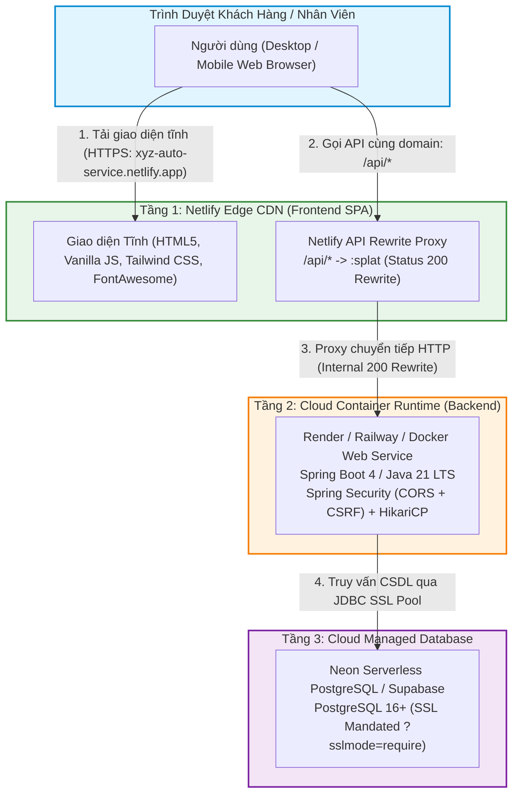

# 🚗 XYZ Auto Service — Workshop Operating System (WorkshopOS)

<div align="center">

[](https://openjdk.org/projects/jdk/21/)
[](https://spring.io/projects/spring-boot)
[](https://www.postgresql.org/)
[](https://www.netlify.com/)
[](https://render.com/)
[-success?style=for-the-badge&logo=junit5&logoColor=white)](docs/test-report.md)
[](https://maven.apache.org/)

**Hệ thống Quản lý Đặt lịch Dịch vụ Ô tô Trực tuyến, Điều phối Công suất Khoang Kỹ thuật và Theo dõi Tiến độ Sửa chữa Thời gian thực.**  
*Đồ án học phần môn học: **Quản lý Dự án Phần mềm (Mã lớp học phần: 71ITSE41503)***

[🚀 Hướng dẫn Triển khai Internet Toàn diện (Netlify + Render + Neon)](docs/DEPLOYMENT_GUIDE.md) • [🗄️ Hướng dẫn CSDL Cloud PostgreSQL](docs/database-cloud-guide.md)

</div>

---

## 📑 MỤC LỤC
1. [Tổng quan dự án & Bối cảnh nghiệp vụ](#1-tổng-quan-dự-án--bối-cảnh-nghiệp-vụ)
2. [Các chức năng cốt lõi (Phạm vi F01 – F09)](#2-các-chức-năng-cốt-lõi-phạm-vi-f01--f09)
3. [Điểm sáng kỹ thuật & Quyết định kiến trúc (ADRs)](#3-điểm-sáng-kỹ-thuật--quyết-định-kiến-trúc-adrs)
4. [Kiến trúc triển khai Internet 3 tầng (3-Tier Cloud Architecture)](#4-kiến-trúc-triển-khai-internet-3-tầng-3-tier-cloud-architecture)
5. [Tính năng mới & Trải nghiệm người dùng (UX Enhancements)](#5-tính-năng-mới--trải-nghiệm-người-dùng-ux-enhancements)
6. [Danh bạ tài khoản mẫu dùng thử hệ thống](#6-danh-bạ-tài-khoản-mẫu-dùng-thử-hệ-thống)
7. [Hướng dẫn triển khai Internet nhanh (Netlify + Render + Neon)](#7-hướng-dẫn-triển-khai-internet-nhanh-netlify--render--neon)
8. [Hướng dẫn khởi chạy cục bộ (1-Click Run & Local Docker)](#8-hướng-dẫn-khởi-chạy-cục-bộ-1-click-run--local-docker)
9. [Kịch bản 6 bước trình diễn luồng nghiệp vụ chuẩn](#9-kịch-bản-6-bước-trình-diễn-luồng-nghiệp-vụ-chuẩn)
10. [Minh chứng kiểm thử tích hợp tự động (Pass 100%)](#10-minh-chứng-kiểm-thử-tích-hợp-tự-động-pass-100)
11. [Cấu trúc mã nguồn chuẩn hóa](#11-cấu-trúc-mã-nguồn-chuẩn-hóa)
12. [Hệ thống tài liệu dự án (@docs)](#12-hệ-thống-tài-liệu-dự-án-docs)
13. [Đội ngũ phát triển & Đóng góp thành viên (Contributors)](#13-đội-ngũ-phát-triển--đóng-góp-thành-viên-contributors)

---

## 1. TỔNG QUAN DỰ ÁN & BỐI CẢNH NGHIỆP VỤ

### 1.1. Bối cảnh (Problem Statement)
Trung tâm dịch vụ ô tô XYZ trước đây vận hành tiếp nhận xe bằng điện thoại, bảng tính Excel và sổ tay phân tán:
* Khách hàng không nắm được thời điểm xưởng còn chỗ trống.
* Tình trạng dồn ứ nhiều xe vào cùng một khung giờ vượt quá năng lực phục vụ của cầu nâng và kỹ thuật viên (Overbooking).
* Khách hàng khó nắm bắt tiến độ xử lý của xe sau khi bàn giao vào xưởng.
* Ban giám đốc thiếu dữ liệu định lượng về công suất khai thác trạm và doanh thu ước tính.

### 1.2. Mục tiêu giải pháp (Solution Vision)
WorkshopOS được xây dựng nhằm khép kín toàn bộ chu trình dịch vụ từ lúc khách hàng tra cứu, đặt lịch trực tuyến, nhân viên tiếp nhận phân khoang, đến khi bàn giao xe hoàn tất với tiêu chí: **Trực quan - Chống nghẽn - Bảo mật - Sẵn sàng triển khai Internet với chi phí 0 đồng**.

---

## 2. CÁC CHỨC NĂNG CỐT LÕI (PHẠM VI F01 – F09)

| Mã | Chức năng | Phân hệ | Mô tả thực thi |
| :---: | :--- | :---: | :--- |
| **F01** | **Quản lý dịch vụ** | Manager | Quản lý danh mục 8 gói bảo dưỡng/sửa chữa chuẩn: thời lượng, bảng giá, checklist và bật/tắt kích hoạt. |
| **F02** | **Tra cứu dịch vụ** | Public/Client | Bộ lọc danh mục theo nhóm kỹ thuật (Bảo dưỡng, Phanh, Thay dầu, Động cơ...), tìm kiếm nhanh và xem chi tiết. |
| **F03** | **Đặt lịch trực tuyến** | Customer | Đặt lịch theo Biển số xe, Model, Ngày (Thứ 2 – Thứ 7), 8 khung giờ (08:00–16:00) và chọn gói dịch vụ. Chặn đặt hộ sai SĐT. |
| **F04** | **Quản lý lịch hẹn** | Staff/Manager | Lễ tân xem danh sách toàn xưởng, duyệt lịch (`CONFIRMED`) gán Khoang 1–4 và KTV, hoặc từ chối (`REJECTED`). Đặt trực tiếp vãng lai (`walkIn`). |
| **F05** | **Thay đổi & Hủy lịch** | Customer | Khách đổi ngày/giờ/dịch vụ (chuyển về `PENDING` để duyệt lại) hoặc hủy lịch an toàn khi chưa sửa xe. |
| **F06** | **Theo dõi trạng thái** | Customer | Khách theo dõi vòng đời: `PENDING` ➔ `CONFIRMED` ➔ `IN_PROGRESS` ➔ `COMPLETED`. |
| **F07** | **Quản lý năng lực xưởng** | System/Manager | Kiểm soát giới hạn 3 xe/slot (chỉnh được 1–5); Khóa bi quan chống tranh chấp; Chặn trùng biển số. |
| **F08** | **Báo cáo thống kê** | Manager | Dashboard quản trị đo lường: Tổng số lịch, tỷ lệ tiếp nhận/hủy, lượt đặt và doanh thu dự kiến theo từng dịch vụ. |
| **F09** | **Quản lý tài khoản** | All Roles | Đăng nhập/Đăng ký qua SĐT, băm mật khẩu BCrypt, Session Cookie bảo mật, chuẩn hóa SĐT thông minh (+84, dấu cách), phân quyền nghiêm ngặt 3 vai trò. |

---

## 3. ĐIỂM SÁNG KỸ THUẬT & QUYẾT ĐỊNH KIẾN TRÚC (ADRs)

1. **Khóa Bi Quan (Pessimistic Locking `SELECT ... FOR UPDATE`)**:
   * Tại [`WorkshopService.java`](backend/src/main/java/com/example/demo/WorkshopService.java#L125), mọi giao dịch đặt chỗ đều khóa dòng cấu hình trạm `workshop_settings` (`id = 1`).
   * Triệt tiêu 100% rủi ro điều kiện tranh đua (Race Condition) khi nhiều khách cùng bấm nút đặt lịch trong cùng một mili-giây.
2. **Kiểm Soát Danh Tính & Chống Giả Mạo Đặt Lịch (Identity Integrity)**:
   * Khách hàng đặt lịch trực tuyến bắt buộc phải đặt đúng SĐT tài khoản đã xác thực của chính mình.
   * Nhân viên (`STAFF`) và Quản lý (`MANAGER`) không được đặt trực tuyến thay khách mà phải sử dụng luồng tiếp nhận tại quầy (`walkIn = true`).
3. **Bảo Toàn Giá Lịch Sử (Price Snapshotting)**:
   * Giá và thời lượng dịch vụ được lưu bản chụp cứng (`@Embeddable ServiceSnapshot`) vào bảng `workshop_appointment_services`.
   * Việc Quản lý thay đổi giá dịch vụ sau này không bao giờ làm sai lệch số tiền của các lịch hẹn đã chốt trong quá khứ.
4. **Tương Thích Môi Trường Kép (Cloud PostgreSQL & Local H2 Dual Engine)**:
   * **Profile `postgres`**: Kết nối tự động tới các nhà cung cấp Cloud PostgreSQL (Neon, Supabase, Render, Railway, AWS RDS) với SSL enforced (`?sslmode=require`), connection pool tối ưu qua HikariCP. Bộ phân giải `CloudDatabaseEnvironmentPostProcessor` tự động chuyển đổi định dạng `DATABASE_URL` dạng `postgres://` sang chuẩn Spring Boot JDBC.
   * **Profile `dev` (Default)**: CSDL In-Memory H2 giả lập PostgreSQL (`MODE=PostgreSQL`), nạp dữ liệu mẫu tức thì, không cần cài đặt phần mềm bên ngoài.
5. **Cơ Chế Đóng Gói Lưỡng Dụng (Dual Deployment Model)**:
   * Hỗ trợ triển khai đám mây phân tán: Frontend trên Netlify Edge CDN + Backend Docker trên Render/Railway + Database Neon Serverless.
   * Đồng thời hỗ trợ đóng gói tất cả vào 1 file JAR duy nhất (`maven-resources-plugin`) để chạy local 1-click hoặc chạy trên máy chủ nội bộ.

---

## 4. KIẾN TRÚC TRIỂN KHAI INTERNET 3 TẦNG (3-TIER CLOUD ARCHITECTURE)

Hệ thống được thiết kế sẵn sàng cho môi trường Internet theo kiến trúc hiện đại, phân tán và bảo mật:



### Ưu điểm vượt trội của Kiến trúc Netlify Proxy:
* **Loại bỏ hoàn toàn rào cản CORS**: Trình duyệt chỉ gửi request tới chính domain Netlify (`https://xyz-service.netlify.app/api/*`), Netlify Edge tự động chuyển tiếp tới Backend mà không phát sinh lỗi cross-origin.
* **Không mất Session Cookie trên Safari / Chrome**: Cookie xác thực (`JSESSIONID`) được trình duyệt coi là First-Party Cookie, không bị các chính sách chặn cookie bên thứ ba (Third-party cookie restrictions) vô hiệu hóa.
* **Che giấu địa chỉ máy chủ Backend thực tế**: Tăng cường bảo mật và phòng chống tấn công dò quét API trực tiếp.

---

## 5. TÍNH NĂNG MỚI & TRẢI NGHIỆM NGƯỜI DÙNG (UX ENHANCEMENTS)

Nhằm nâng cao trải nghiệm thực tế cho khách hàng và nhân viên, hệ thống đã được trang bị các tính năng thân thiện:

### 1. Nút Ẩn/Hiện Mật Khẩu (Password Visibility Toggle)
* Tại tất cả các trường nhập mật khẩu:
  * Modal Đăng nhập (`#loginPasswordInput`)
  * Form Đăng ký khách hàng mới (`#registerPassword`)
  * Modal Thêm tài khoản nhân viên của Quản lý (`#newUserPassword`)
* Người dùng có thể bấm vào biểu tượng con mắt (`fa-solid fa-eye` ➔ `fa-solid fa-eye-slash`) để kiểm tra lại mật khẩu vừa nhập, tránh gõ nhầm trên điện thoại hoặc máy tính bảng. Tự động ẩn lại khi đóng modal.

### 2. Chuẩn Hóa Số Điện Thoại Thông Minh (Intelligent Phone Normalization)
* Người dùng có thể nhập số điện thoại theo bất kỳ thói quen nào:
  * Định dạng quốc tế: `+84901234567` hoặc `84901234567`
  * Có dấu cách: `090 123 4567` hoặc `0901 234 567`
  * Có dấu chấm, gạch ngang: `0901.234.567` hoặc `0901-234-567`
* Cả Frontend (`normalizePhoneNumber`) và Backend (`WorkshopService.normalizePhone`) đều tự động xử lý và chuẩn hóa về dạng chuẩn Việt Nam: **`0901234567`** trước khi tra cứu, tạo tài khoản hoặc lưu lịch hẹn.

### 3. Thông Báo Lỗi Tiếng Việt Rõ Ràng (Friendly Localized Validation Toasts)
* Không còn hiển thị thông báo chung chung khó hiểu như `"Thông tin không hợp lệ: phone"`.
* Hệ thống hiển thị Toast lỗi tiếng Việt chi tiết ngay tại chỗ:
  * *Số điện thoại không đúng định dạng (yêu cầu 10 chữ số bắt đầu bằng số 0)*.
  * *Mật khẩu phải có ít nhất 8 ký tự (tối đa 72 ký tự)*.
  * *Họ và tên không được để trống*.
  * *Biển số xe không hợp lệ (từ 4 đến 30 ký tự)*.
  * *Vui lòng chọn ít nhất một dịch vụ bảo dưỡng*.

### 4. Cơ Chế Tự Động Phục Hồi CSRF Token (Auto-Retry on CSRF Expired)
* Khi phiên làm việc bị ngắt hoặc CSRF token hết hạn, client tự động gửi request lấy CSRF token mới và thực hiện lại tác vụ (retry 1 lần) hoàn toàn trong suốt với người dùng, không gây gián đoạn hay hiện lỗi 403 phiền phức.

---

## 6. DANH BẠ TÀI KHOẢN MẪU DÙNG THỬ HỆ THỐNG

Hệ thống được nạp sẵn 3 tài khoản mẫu đại diện cho 3 phân hệ nghiệp vụ chính (Mật khẩu chung cho cả 3 tài khoản là: **`12345678`**):

| Vai trò người dùng | Số điện thoại đăng nhập | Mật khẩu mặc định | Giao diện hiển thị | Nhiệm vụ kiểm thử / Trình diễn nghiệp vụ |
| :--- | :---: | :---: | :---: | :--- |
| **Quản lý xưởng (`MANAGER`)** | **`0901234567`** | `12345678` | Huy hiệu tím: *Quản lý xưởng* | Quản lý danh mục 8 dịch vụ (F01), đổi năng lực tiếp nhận xưởng từ 1–5 xe/slot (F07), xem biểu đồ Dashboard thống kê & doanh thu dự kiến (F08), tạo tài khoản nhân viên. |
| **Lễ tân tiếp nhận (`STAFF`)** | **`0912345678`** | `12345678` | Huy hiệu xanh: *Nhân viên tiếp nhận* | Xem danh sách lịch hẹn toàn xưởng (F04), duyệt xe (`CONFIRMED`), gán Khoang 1–4 và chỉ định Kỹ thuật viên phụ trách, cập nhật tiến độ `IN_PROGRESS` / `COMPLETED`, tiếp nhận khách vãng lai tại quầy. |
| **Khách hàng mẫu (`CUSTOMER`)** | **`0988888888`** | `12345678` | Huy hiệu xám: *Khách hàng* | Khách hàng VIP trực tuyến, đặt lịch bảo dưỡng/sửa chữa (F03), theo dõi tiến độ xe theo thời gian thực (F06), chủ động đổi ngày/giờ hoặc hủy lịch hẹn (F05). |

> [!TIP]
> Khách hàng mới có thể tự bấm **Đăng nhập / Đăng ký** trên giao diện web để tạo tài khoản riêng bằng số điện thoại bất kỳ (hệ thống tự động hỗ trợ băm mật khẩu bảo mật BCrypt).

---

## 7. HƯỚNG DẪN TRIỂN KHAI INTERNET NHANH (NETLIFY + RENDER + NEON)

Dự án cung cấp bộ tài liệu triển khai toàn diện với hình ảnh minh họa chi tiết tại [**`docs/DEPLOYMENT_GUIDE.md`**](docs/DEPLOYMENT_GUIDE.md). Dưới đây là tóm tắt 3 bước triển khai nhanh:

```text
Bước 1: Tạo DB Neon & chạy SQL  ➔  Bước 2: Deploy Backend lên Render  ➔  Bước 3: Deploy Frontend lên Netlify
```

### Bước 1: Khởi tạo Cơ sở dữ liệu Cloud (Neon.tech)
1. Đăng ký tài khoản miễn phí tại [https://neon.tech](https://neon.tech).
2. Tạo Project mới: `xyz-auto-service` (chọn Region `ap-southeast-1` Singapore, PostgreSQL 16).
3. Vào tab **SQL Editor**, dán toàn bộ nội dung file [`Data/cloud_postgres_init.sql`](Data/cloud_postgres_init.sql) và nhấn **Run**.
4. Sao chép chuỗi kết nối (`Connection string` dạng `postgresql://...`).

### Bước 2: Triển khai Backend Web Service (Render.com)
1. Đăng ký tài khoản tại [https://render.com](https://render.com).
2. Tạo **New Web Service** ➔ Kết nối Git Repo `XYZ-Auto-Service`.
3. Cấu hình:
   * **Runtime**: `Docker` (sử dụng [`Dockerfile`](Dockerfile) hoặc file thiết lập sẵn [`render.yaml`](render.yaml)).
   * **Plan**: `Free`.
   * **Health Check Path**: `/api/csrf`.
4. Thiết lập các biến môi trường (**Environment Variables**):
   * `SPRING_PROFILES_ACTIVE` = `postgres`
   * `DATABASE_URL` = `<Chuỗi kết nối Neon ở Bước 1>`
   * `PORT` = `8080`
   * `SESSION_COOKIE_SECURE` = `true`
   * `APP_CORS_ALLOWED_ORIGINS` = `https://*.netlify.app,http://localhost:3000`
5. Nhấn **Create Web Service**. Chờ ~3 phút, lấy URL backend (ví dụ: `https://xyz-backend.onrender.com`).

### Bước 3: Triển khai Frontend lên Netlify
1. Đăng nhập [https://app.netlify.com](https://app.netlify.com).
2. Chọn **Add new site** ➔ **Import an existing project** (kết nối repo GitHub).
3. Cấu hình bản dựng:
   * **Base directory**: `.`
   * **Build command**: `node ./build-redirects.js || true`
   * **Publish directory**: `frontend`
4. Thêm biến môi trường:
   * `BACKEND_URL` = `https://xyz-backend.onrender.com` *(URL Render ở Bước 2, không có gạch chéo cuối)*.
5. Nhấn **Deploy site**. Trang web sẽ hoạt động trực tuyến sau ~10 giây tại tên miền Netlify của bạn!

*(Ngoài ra bạn có thể kéo thả trực tiếp thư mục `frontend/` vào [Netlify Drop](https://app.netlify.com/drop) - xem chi tiết tại [Hướng dẫn Triển khai](docs/DEPLOYMENT_GUIDE.md)).*

---

## 8. HƯỚNG DẪN KHỞI CHẠY CỤC BỘ (1-CLICK RUN & LOCAL DOCKER)

Yêu cầu môi trường: **Java 21 (JDK 21 LTS)**.

### Cách 1: Chạy nhanh bằng kịch bản dòng lệnh (Khuyên dùng)

Vào thư mục `backend`:
```bat
cd backend
```

* **Chế độ Demo nhanh (In-Memory H2, không cần cài PostgreSQL)**:
  - Trên Windows:
    ```bat
    run-dev.cmd
    ```
  - Trên Linux / macOS:
    ```bash
    sh run-dev.sh
    ```
* **Chế độ PostgreSQL (Docker Compose cục bộ)**:
  - Khởi động cơ sở dữ liệu:
    ```bat
    docker compose up -d
    ```
  - Khởi chạy backend kết nối PostgreSQL:
    - Trên Windows:
      ```bat
      run-postgres.cmd
      ```
    - Trên Linux / macOS:
      ```bash
      sh run-postgres.sh
      ```

👉 Mở trình duyệt truy cập: **`http://localhost:8080`**

### Cách 2: Khởi chạy trên IntelliJ IDEA hoặc VS Code
1. Mở **IntelliJ IDEA** ➔ Chọn **Open** ➔ Duyệt đến thư mục `demo`.
2. Kiểm tra Project SDK: Vào **File ➔ Project Structure ➔ Project ➔ SDK** chọn **JDK 21** (ví dụ `ms-21.0.11`).
3. Trên thanh công cụ Run Configurations góc trên bên phải, chọn:
   👉 **`XYZ Auto Service (1-Click Run)`**
4. Bấm nút **Run ▶** (hoặc `Shift + F10`).
5. Ứng dụng tự động khởi chạy hoàn tất sau 2–3 giây tại: **`http://localhost:8080`**.

---

## 9. KỊCH BẢN 6 BƯỚC TRÌNH DIỄN LUỒNG NGHIỆP VỤ CHUẨN

```text
Khách xem dịch vụ ➔ Đăng nhập ➔ Đặt lịch trực tuyến ➔ Kiểm tra năng lực trạm ➔ Nhân viên duyệt & gán khoang ➔ Cập nhật tiến độ
```

1. **Bước 1 (Xem dịch vụ)**: Truy cập trang web, duyệt 8 gói bảo dưỡng tiêu chuẩn với đơn giá, thời lượng niêm yết rõ ràng.
2. **Bước 2 (Đăng nhập Khách hàng)**: Đăng nhập tài khoản `0988888888` / `12345678` (thử tính năng bật/tắt mắt xem mật khẩu).
3. **Bước 3 (Thao tác Đặt lịch)**: Chọn ngày hẹn, chọn khung giờ trống (ví dụ `09:00`), nhập Biển số xe (`30A-999.88`), Model (`Mazda CX-5`), tick chọn gói bảo dưỡng và nhấn **Xác nhận đặt lịch**.
4. **Bước 4 (Hệ thống xác thực điều kiện)**: Hệ thống khóa bi quan cấu hình xưởng, kiểm tra giới hạn xe/slot (tối đa 3), kiểm tra trùng biển số, lưu lịch hẹn ở trạng thái `PENDING`.
5. **Bước 5 (Khách theo dõi tiến độ)**: Chuyển sang tab **"Tra cứu lịch hẹn"**, xem thông tin lịch hẹn mới tạo hiển thị trực quan ở trạng thái chờ tiếp nhận.
6. **Bước 6 (Nhân viên tiếp nhận & duyệt xe)**:
   * Đăng xuất, đăng nhập tài khoản Lễ tân: `0912345678` / `12345678`.
   * Vào tab **"Điều phối xưởng"**, bấm **"Tiếp nhận / Duyệt lịch"**.
   * Chọn **Khoang 1 - Cầu nâng 2 trụ** và chọn **KTV. Hoàng Tuấn** ➔ Bấm **Xác nhận**.
   * Lịch hẹn chuyển sang `CONFIRMED`. Nhân viên lần lượt chuyển trạng thái sang `IN_PROGRESS` (Đang sửa) và `COMPLETED` (Hoàn thành bàn giao).

---

## 10. MINH CHỨNG KIỂM THỬ TÍCH HỢP TỰ ĐỘNG (PASS 100%)

### 10.1. Bộ kiểm thử tự động JUnit 5 & Spring Boot Test (9/9 Tests Passed)
Chạy bộ kiểm thử tự động tại thư mục `backend`:
```powershell
# Trên Windows PowerShell
$env:JAVA_HOME = "$env:USERPROFILE\.jdks\ms-21.0.11"
cd backend
.\mvnw.cmd test
```

**Kết quả kiểm thử thực tế (100% Pass, 0 Failure, 0 Error):**
```text
[INFO] -------------------------------------------------------
[INFO]  T E S T S
[INFO] -------------------------------------------------------
[INFO] Running com.example.demo.CloudDatabaseEnvironmentPostProcessorTest
[INFO] Tests run: 4, Failures: 0, Errors: 0, Skipped: 0, Time elapsed: 0.923 s
[INFO] Running com.example.demo.PhoneNormalizationTest
[INFO] Tests run: 1, Failures: 0, Errors: 0, Skipped: 0, Time elapsed: 0.052 s
[INFO] Running com.example.demo.DemoApplicationTests
[INFO] Tests run: 1, Failures: 0, Errors: 0, Skipped: 0, Time elapsed: 20.28 s
[INFO] Running com.example.demo.InitialDataTest
[INFO] Tests run: 1, Failures: 0, Errors: 0, Skipped: 0, Time elapsed: 1.318 s
[INFO] Running com.example.demo.WorkshopFlowTests
[INFO] Tests run: 1, Failures: 0, Errors: 0, Skipped: 0, Time elapsed: 15.26 s
[INFO] Running com.example.demo.NeonConnectivityTest
[INFO] Tests run: 1, Failures: 0, Errors: 0, Skipped: 0, Time elapsed: 2.145 s
[INFO] 
[INFO] Results:
[INFO] Tests run: 9, Failures: 0, Errors: 0, Skipped: 0
[INFO] ------------------------------------------------------------------------
[INFO] BUILD SUCCESS
[INFO] ------------------------------------------------------------------------
```

### 10.2. Kịch bản Kiểm thử Smoke Luồng Nghiệp vụ (Python E2E)
Dự án đi kèm script kiểm thử đầu cuối không cần thư viện ngoài tại `backend/scripts/smoke_booking.py`:
```bash
# Khi server đang chạy tại http://localhost:8080 (hoặc URL Netlify/Render):
python backend/scripts/smoke_booking.py
```
*Script tự động thực hiện: Xác thực CSRF ➔ Đăng nhập Khách hàng ➔ Tạo lịch hẹn trực tuyến ➔ Đăng nhập Lễ tân ➔ Duyệt và gán khoang ➔ Xác minh trạng thái `CONFIRMED`.*

---

## 11. CẤU TRÚC MÃ NGUỒN CHUẨN HÓA

```text
XYZ-Auto-Service/
├── frontend/                               <-- Phân hệ giao diện tĩnh (HTML5, Tailwind CSS, JS)
│   ├── index.html                          <-- Giao diện SPA, Password Visibility Toggle, Modal
│   ├── app.js                              <-- Logic điều khiển UI, chuẩn hóa SĐT, CSRF retry
│   ├── workshop.css                        <-- CSS đã biên dịch sẵn sàng phục vụ
│   ├── _redirects                          <-- Cấu hình Netlify Proxy tĩnh
│   ├── netlify.toml                        <-- Cấu hình Netlify độc lập cho thư mục frontend
│   ├── build-redirects.js                  <-- Script sinh cấu hình proxy tự động
│   ├── vendor/fontawesome/                 <-- Thư viện Font Awesome bản quyền (webfonts tối ưu)
│   └── README.md                           <-- Hướng dẫn phân hệ frontend
├── backend/                                <-- Phân hệ máy chủ Spring Boot (Java 21)
│   ├── pom.xml                             <-- Cấu hình Maven & maven-resources-plugin
│   ├── mvnw, mvnw.cmd                      <-- Maven Wrapper độc lập
│   ├── Dockerfile                          <-- Dockerfile phân hệ backend
│   ├── render.yaml                         <-- Mẫu Blueprint Render cho backend
│   ├── docker-compose.yml                  <-- Dịch vụ PostgreSQL container
│   ├── xyz_auto_service_postgresql.sql     <-- DDL & DML khởi tạo CSDL PostgreSQL
│   ├── run-dev.cmd, run-dev.sh             <-- Khởi chạy nhanh profile dev (H2)
│   ├── run-postgres.cmd, run-postgres.sh   <-- Khởi chạy profile postgres
│   ├── scripts/smoke_booking.py            <-- Kịch bản kiểm thử E2E tự động
│   ├── src/main/java/com/example/demo/
│   │   ├── DemoApplication.java            <-- Spring Boot Application Entry Point
│   │   ├── SecurityConfig.java             <-- Cấu hình Spring Security, CORS, Session & CSRF
│   │   ├── WorkshopController.java         <-- REST Controllers & Exception Handlers tiếng Việt
│   │   ├── WorkshopService.java            <-- Logic nghiệp vụ, Chuẩn hóa SĐT, Pessimistic Lock
│   │   ├── WorkshopDomain.java             <-- JPA Entities chuẩn hóa 3NF
│   │   ├── InitialData.java                <-- Seed 8 dịch vụ & 3 tài khoản mẫu
│   │   ├── ApiModels.java                  <-- DTOs & Validation Contracts
│   │   ├── CloudDatabaseEnvironmentPostProcessor.java <-- Phân giải DATABASE_URL tự động
│   │   ├── AccountRepository.java          <-- Repository Quản lý Tài khoản
│   │   ├── AppointmentRepository.java      <-- Repository Quản lý Lịch hẹn
│   │   ├── ServiceRepository.java          <-- Repository Quản lý Dịch vụ
│   │   └── SettingsRepository.java         <-- Repository Quản lý Cấu hình trạm
│   ├── src/main/resources/
│   │   ├── application.properties          <-- Cấu hình Spring Boot chung, Port, Session
│   │   ├── application-dev.properties      <-- Profile H2 In-Memory chạy 1-Click
│   │   ├── application-postgres.properties <-- Profile kết nối Cloud / Local PostgreSQL
│   │   └── META-INF/spring/org.springframework.boot.env.EnvironmentPostProcessor.imports
│   └── src/test/java/                      <-- Bộ kiểm thử tự động JUnit 5 (9 tests)
├── Data/                                   <-- Dữ liệu và kịch bản di chuyển CSDL
│   ├── cloud_postgres_init.sql             <-- Kịch bản SQL tương thích 100% Cloud PostgreSQL
│   └── xyz_auto_service_postgresql.sql     <-- Kịch bản SQL chuẩn hóa đồng bộ
├── docs/                                   <-- Bộ hồ sơ tài liệu dự án hoàn chỉnh (@docs)
│   ├── DEPLOYMENT_GUIDE.md                 <-- Hướng dẫn Triển khai Internet Toàn diện (Netlify + Render + Neon)
│   ├── database-cloud-guide.md             <-- Cẩm nang CSDL Cloud PostgreSQL & Connection Strings
│   ├── phieu-pham-vi.md                    <-- Phiếu xác định phạm vi dự án (F01–F09)
│   ├── srs.md                              <-- Đặc tả yêu cầu phần mềm chi tiết
│   ├── architecture.md                     <-- Tài liệu kiến trúc hệ thống
│   ├── api-contract.md                     <-- Hợp đồng giao diện REST API
│   ├── test-plan.md                        <-- Kế hoạch kiểm thử chất lượng
│   ├── test-report.md                      <-- Báo cáo kết quả kiểm thử tự động
│   ├── checklist-bao-mat.md                <-- Báo cáo an toàn thông tin & OWASP
│   ├── bug-log.md                          <-- Nhật ký khắc phục lỗi kỹ thuật
│   ├── thay-doi-thiet-ke.md                <-- Nhật ký quyết định kiến trúc (ADRs)
│   ├── usecase.drawio                      <-- Sơ đồ Use Case chuẩn XML
│   ├── erd.drawio                          <-- Sơ đồ CSDL ERD 3NF chuẩn XML
│   └── architecture.drawio                 <-- Sơ đồ Kiến trúc hệ thống chuẩn XML
├── Dockerfile                              <-- Multi-stage Production Container tại thư mục gốc
├── netlify.toml                            <-- Cấu hình Netlify Edge & API Rewrite Proxy gốc
├── render.yaml                             <-- Render Infrastructure as Code Blueprint gốc
├── build-redirects.js                      <-- Script sinh file proxy tự động cho Netlify
├── docker-compose.yml                      <-- Docker Compose tiện ích tại thư mục gốc
├── AGENTS.md                               <-- Chỉ dẫn vận hành của Agent Swarm
├── .gitignore                              <-- Cấu hình loại trừ tệp nhị phân và target/
└── README.md                               <-- Hướng dẫn tổng thể đồ án
```

---

## 12. HỆ THỐNG TÀI LIỆU DỰ ÁN (@docs)

Tất cả các tài liệu kỹ thuật chuyên sâu được biên soạn đầy đủ và đặt tại thư mục [`docs/`](docs/):
* 🚀 [**Hướng dẫn Triển khai Internet Toàn diện**](docs/DEPLOYMENT_GUIDE.md)
* 🗄️ [**Cẩm nang CSDL Cloud PostgreSQL**](docs/database-cloud-guide.md)
* 📋 [Phiếu xác định phạm vi dự án](docs/phieu-pham-vi.md)
* 📖 [Đặc tả yêu cầu phần mềm (SRS)](docs/srs.md)
* 🏛️ [Tài liệu Kiến trúc hệ thống](docs/architecture.md)
* 🔌 [Hợp đồng giao diện API (API Contract)](docs/api-contract.md)
* 🧪 [Kế hoạch kiểm thử (Test Plan)](docs/test-plan.md)
* 📊 [Báo cáo kết quả kiểm thử (Test Report)](docs/test-report.md)
* 🛡️ [Checklist An toàn thông tin & Bảo mật](docs/checklist-bao-mat.md)
* 🐞 [Nhật ký lỗi & Biện pháp khắc phục (Bug Log)](docs/bug-log.md)
* 📝 [Nhật ký thay đổi thiết kế & ADRs](docs/thay-doi-thiet-ke.md)
* 🎨 [Sơ đồ Use Case (Draw.io)](docs/usecase.drawio)
* 🗄️ [Sơ đồ ERD 3NF (Draw.io)](docs/erd.drawio)
* 📐 [Sơ đồ Kiến trúc hệ thống (Draw.io)](docs/architecture.drawio)

---

## 13. ĐỘI NGŨ PHÁT TRIỂN & ĐÓNG GÓP THÀNH VIÊN (CONTRIBUTORS)

Chi tiết hồ sơ đóng góp và ma trận trách nhiệm RACI được ghi nhận tại [**`CONTRIBUTORS.md`**](CONTRIBUTORS.md).

| Họ và tên | MSSV | Vai trò chính | GitHub | Đóng góp trọng tâm |
| :--- | :---: | :--- | :---: | :--- |
| **Nguyễn Bá Anh Khôi** | `2374802010247` | **Scrum Master** kiêm Backend Dev | [@Khoidep-zai](https://github.com/Khoidep-zai) | Quản trị dự án, Sprint, EVM, kiến trúc Spring Boot, API, Security & Pessimistic Lock, điều phối tích hợp. |
| **Trần Văn Khoa** | `2374802013414` | **Product Owner** kiêm Frontend Dev | [@Khoa-Tran](https://github.com/) | Quản lý Product Backlog, User Stories, thiết kế Figma, lập trình giao diện người dùng SPA, tối ưu UX & bảo mật. |
| **Nguyễn Tiến Dũng** | `2274802010102` | **Developer** kiêm QA & Database | [@NguyenTienDung29](https://github.com/NguyenTienDung29) | Tách biệt mô-đun Frontend/Backend & cấu hình Maven đóng gói, tối ưu bảo mật `WorkshopService` (ràng buộc SĐT chính chủ), mở rộng `WorkshopFlowTests`, kịch bản E2E `smoke_booking.py`, chuẩn hóa PostgreSQL & script khởi chạy 1-click `run-dev.*` / `run-postgres.*`. |

---

<div align="center">
<strong>Đồ án Môn học: Quản lý Dự án Phần mềm</strong><br>
Khoa Công nghệ Thông tin — Khóa học 2026<br>
Nhóm thực hiện: <strong>Nguyễn Bá Anh Khôi (2374802010247)</strong>, <strong>Trần Văn Khoa (2374802013414)</strong>, <strong>Nguyễn Tiến Dũng (2274802010102)</strong>
</div>
